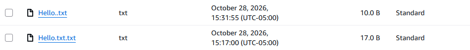

AWS SECURE S3 STORAGE PROJECT
I CREATED AN AWS S3 BUCKET TO PRACTICE SECURE CLOUD STORAGE. I UPLOADED A TEST FILE, CHECKED ITS PERMISSONS, AND VERIFIED THAT PUBLIC ACSSES IS DENIED
THIS PROJECT DEMOSTRATES MY UNDERSTANDINGS OF AWS S3 , CLOUD STORAGE AND BASIC SECURITY TESTING 

## Security Controls Verified

- **Block Public Access:** Enabled on the bucket, so the bucket and its objects cannot be made public.
- **Encryption at rest:** Default encryption is SSE-S3 (Amazon S3 managed keys). SSE-C uploads are blocked.
- **Versioning:** Enabled. The first test upload shows a null version ID because it was uploaded before versioning was turned on. Later uploads have unique version IDs.

## IAM Access Control (Least Privilege)

- **IAM user:** s3-training-user, a test user created to practice read-only access.
- **Group:** s3-view-only. The user receives permissions through this group.
- **Policy:** s3-portfolio-read-only-policy allows only s3:GetObject and s3:ListBucket on this bucket and the objects inside it.
- **No write or delete access:** The policy contains no PutObject or DeleteObject permissions.

## Testing and Validation

- Used the IAM Policy Simulator on s3-training-user.
- **s3:GetObject:** Allowed (explicit allow in the group policy).
- **s3:PutObject:** Implicitly denied (no matching allow statement).
- Result: the user can read objects but cannot upload or change them.

## Cost Awareness

- S3 charges for storage used, requests made, and data transferred out. For a small practice bucket with a few tiny files, expected cost is very low, but I check the AWS Billing dashboard to confirm actual charges.
- Versioning keeps old copies of files, which can increase storage over time. A lifecycle rule to expire old versions is a planned future improvement.
- IAM users, groups, and policies have no charge.

## Architecture

- **Amazon S3 bucket:** aws-secure-storage-portfolio-2026 in us-east-1 stores the project files.
- **IAM user:** s3-training-user is the test identity.
- **IAM group:** s3-view-only holds the user and carries the permissions.
- **IAM policy:** s3-portfolio-read-only-policy grants read-only access to the bucket.
- **Access flow:** user, then group, then policy, then bucket. The user can list and read objects but cannot write or delete.

